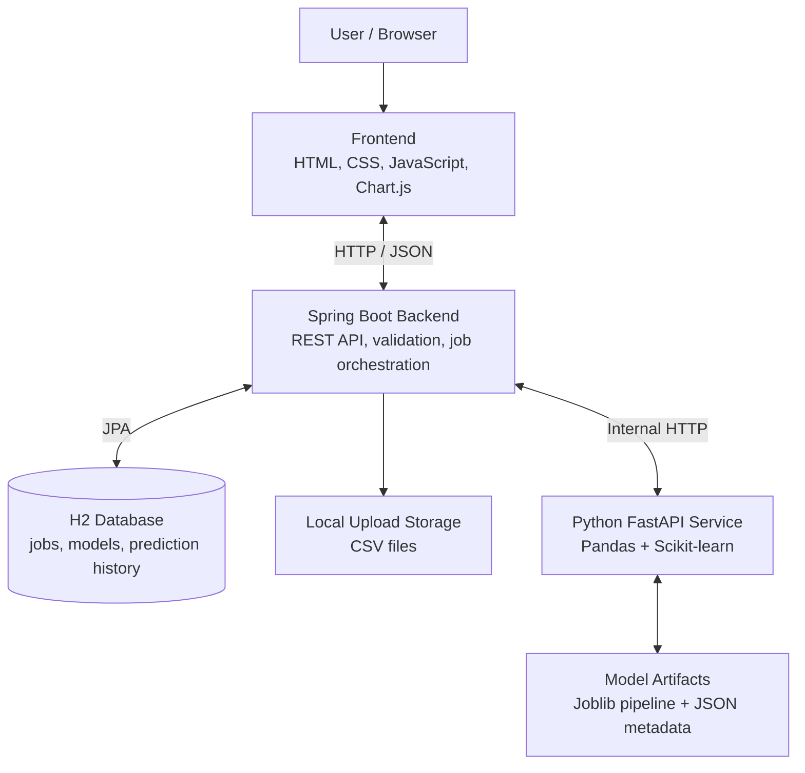
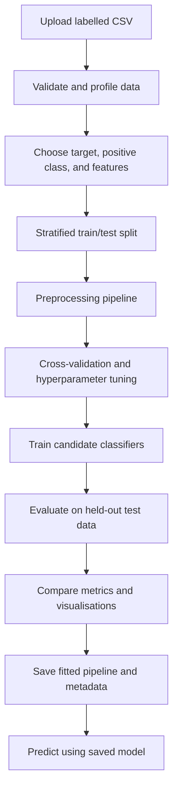

# GlucoGuard — Diabetes Risk Prediction & ML Experimentation Platform

**An educational full-stack application for uploading tabular datasets, training and comparing machine-learning classification models, and generating predictions through a web interface.**

<p align="center">
  <b>Java · Spring Boot · Python · FastAPI · Scikit-learn · H2 · Chart.js</b>
</p>

> **Educational use only:** GlucoGuard is not a medical device and does not diagnose diabetes. Predictions and scores depend on the uploaded dataset and the trained model. Do not use this application for medical decisions.

---

## Table of Contents

- [Overview](#overview)
- [Features](#features)
- [Technology Stack](#technology-stack)
- [Architecture](#architecture)
- [Machine-Learning Workflow](#machine-learning-workflow)
- [Project Structure](#project-structure)
- [Getting Started](#getting-started)
- [Using the Application](#using-the-application)
- [CSV Requirements](#csv-requirements)
- [REST API](#rest-api)
- [Evaluation and Demonstration Results](#evaluation-and-demonstration-results)
- [Testing and Verification](#testing-and-verification)
- [Storage and Configuration](#storage-and-configuration)
- [Security and Privacy](#security-and-privacy)
- [Limitations and Future Work](#limitations-and-future-work)
- [Contributors](#contributors)
- [Acknowledgements](#acknowledgements)

---

## Overview

GlucoGuard (the project report title) is a web-based machine-learning experimentation platform focused on diabetes-related binary classification. It turns a typical notebook-based ML workflow into a guided application.

Users can upload a labelled CSV file, inspect its structure, choose a target and input features, configure a training experiment, compare classification algorithms, review evaluation metrics and charts, and make predictions using saved models.

The application is built with a **Java Spring Boot backend** and a separate **Python FastAPI ML service**. Spring Boot serves the frontend and owns the public REST API, request validation, asynchronous training-job lifecycle, and application metadata. The Python service handles dataset profiling, preprocessing, model training, evaluation, persistence, and inference.

The bundled demonstration dataset is synthetic. It is intended to demonstrate the software workflow, not to establish clinical performance.

## Features

### Dataset upload and inspection
- Upload a labelled CSV through the browser.
- Preview records and inspect detected column types.
- Review missing values, duplicate rows, class distribution, and validation warnings.
- Select the target column, positive class, and input features.
- Detect and warn about identifier-like, constant, empty, and high-missing-value columns.

### Model training and comparison
Train and compare:
- Logistic Regression
- Random Forest
- Decision Tree (optional)

Configure:
- Train/test split
- Evaluation/scoring metric
- Hyperparameter tuning level
- Random seed
- Candidate algorithms

### Evaluation and visualisation
Review:
- Accuracy, precision, recall, F1-score, and ROC-AUC
- Confusion matrices
- ROC curves
- Model comparison charts
- Feature importance or Logistic Regression coefficients, where supported

Download a training report in JSON or CSV format.

### Prediction with saved models
- Select a previously trained model.
- Enter values using a form generated from that model's feature schema.
- Receive a predicted class and model-estimated probability.
- See warnings for values outside the training range.
- Review prediction history.

### Training history and asynchronous jobs
Training runs as a background job rather than holding the initial HTTP request open. Jobs move through:

`QUEUED → RUNNING → COMPLETED`

or

`QUEUED / RUNNING → FAILED`

The browser polls the backend for job status and displays the results when training finishes.

---

## Technology Stack

| Layer | Technology | Responsibility |
|---|---|---|
| Frontend | HTML5, CSS3, Vanilla JavaScript | Pages, wizard, forms, and interactions |
| Visualisation | Chart.js | Metric charts, ROC curves, and result visualisation |
| Application backend | Java 17+, Spring Boot 3 | REST API, validation, orchestration, and job management |
| Persistence | Spring Data JPA, H2 | Training jobs, model metadata, and prediction history |
| ML service | Python, FastAPI, Uvicorn | Dataset inspection, training, evaluation, and prediction |
| Data processing | Pandas, NumPy | Tabular data handling |
| Machine learning | Scikit-learn | Preprocessing, classification, cross-validation, and tuning |
| Model persistence | Joblib | Saving and loading fitted ML pipelines |
| Build | Maven | Java dependency and build management |

---

## Architecture

The browser communicates with Spring Boot. Spring Boot communicates internally with the Python ML service. The browser does **not** call the ML service directly.



### Request flow

1. The browser sends requests to the Spring Boot application on port `8080`.
2. For CSV inspection, Spring Boot validates the upload and forwards it to FastAPI. The ML service returns a dataset profile.
3. For training, Spring Boot stores the uploaded CSV, creates a job in H2, and queues it for a bounded background worker.
4. The worker sends the CSV and configuration to FastAPI.
5. Python validates the data, creates the train/test split, preprocesses features, tunes candidate models using cross-validation on training data, and evaluates them on the held-out test set.
6. The Python service saves fitted preprocessing-and-model pipelines using Joblib and returns metrics and metadata.
7. Spring Boot persists job and model metadata. The browser retrieves the completed results.
8. For prediction, Spring Boot validates the input schema and asks FastAPI to load the saved pipeline and make a prediction. Prediction history stores the predicted class and probability, not the raw input values.

---

## Machine-Learning Workflow



### Preprocessing

The application uses a preprocessing pipeline so that transformations are fitted on training data and reused consistently at prediction time.

| Feature type | Processing |
|---|---|
| Numerical | Median imputation and standardisation |
| Categorical | Most-frequent imputation and one-hot encoding |

The fitted preprocessing steps remain attached to the classifier in the saved pipeline.

### Preventing data leakage

The test set is separated before preprocessing and hyperparameter tuning. Cross-validation and model selection use training data only. The held-out test set is reserved for final evaluation. This prevents information from the test set from influencing the fitted transformations or model selection.

---

## Project Structure

```text
diabetes-risk-prediction/
├── README.md
├── .gitignore
├── .env.example
│
├── backend/
│   ├── pom.xml
│   └── src/
│       ├── main/
│       │   ├── java/edu/ait/diabetesrisk/
│       │   │   ├── client/
│       │   │   ├── config/
│       │   │   ├── controller/
│       │   │   ├── dto/
│       │   │   ├── entity/
│       │   │   ├── exception/
│       │   │   ├── repository/
│       │   │   ├── service/
│       │   │   └── DiabetesRiskApplication.java
│       │   └── resources/
│       │       ├── application.properties
│       │       ├── application-local.properties
│       │       └── static/
│       │           ├── css/
│       │           ├── fonts/
│       │           ├── js/
│       │           ├── sample/
│       │           ├── vendor/
│       │           ├── index.html
│       │           ├── train.html
│       │           ├── results.html
│       │           ├── predict.html
│       │           └── history.html
│       └── test/
│
├── ml-service/
│   ├── app/
│   │   ├── main.py
│   │   ├── schemas.py
│   │   ├── config.py
│   │   ├── errors.py
│   │   ├── data_validation.py
│   │   ├── preprocessing.py
│   │   ├── training.py
│   │   ├── evaluation.py
│   │   ├── prediction.py
│   │   └── artifact_store.py
│   ├── tests/
│   └── requirements.txt
│
├── sample-data/
│   └── synthetic_diabetes_demo.csv
│
└── scripts/
    ├── run-ml.sh
    ├── run-ml.bat
    ├── run-backend.sh
    ├── run-backend.bat
    └── generate_synthetic_data.py
```

Generated runtime data (uploads, H2 database files, and trained model artifacts) is stored locally and should not be committed to Git.

---

## Getting Started

### Prerequisites

Install the following:

| Tool | Version | Check |
|---|---|---|
| Java JDK | 17 or 21 | `java -version` |
| Maven | 3.9+ | `mvn -v` |
| Python | 3.10+ | `python --version` |
| Git | Recent version | `git --version` |
| Browser | Current Chrome, Edge, Firefox, or Safari | — |

The frontend assets are bundled locally. The first Maven build and Python dependency installation require internet access to download dependencies.

### 1. Clone the repository

```bash
git clone https://github.com/YOUR_USERNAME/diabetes-risk-prediction.git
cd diabetes-risk-prediction
```

Replace `YOUR_USERNAME` with your GitHub username.

### 2. Start the Python ML service

Open a terminal in the project root.

**Windows PowerShell:**

```powershell
cd ml-service
py -3 -m venv .venv
.\.venv\Scripts\Activate.ps1
python -m pip install --upgrade pip
pip install -r requirements.txt
python -m uvicorn app.main:app --host 127.0.0.1 --port 8000
```

If PowerShell blocks virtual-environment activation, use Command Prompt and run:

```bat
.venv\Scripts\activate
```

**Linux / macOS:**

```bash
cd ml-service
python3 -m venv .venv
source .venv/bin/activate
python -m pip install --upgrade pip
pip install -r requirements.txt
uvicorn app.main:app --host 127.0.0.1 --port 8000
```

The ML service runs at `http://127.0.0.1:8000`.

### 3. Start the Spring Boot backend

Open a **second terminal** in the project root.

**Windows, macOS, or Linux:**

```bash
cd backend
mvn spring-boot:run -Dspring-boot.run.profiles=local
```

For PowerShell, quote the Maven property if required:

```powershell
mvn spring-boot:run "-Dspring-boot.run.profiles=local"
```

Alternatively, open the `backend` folder in IntelliJ IDEA and run `DiabetesRiskApplication.java`.

The Spring Boot application serves the frontend at:

`http://localhost:8080`

The local profile enables the H2 console for localhost development only. Do not enable it on a public deployment.

### 4. Open the application

Visit:

**http://localhost:8080**

Keep both terminal processes running while using the application.

---

## Using the Application

1. Open the **Train Model** page.
2. Choose the bundled synthetic demo CSV or upload your own labelled CSV.
3. Select the binary target column and confirm the positive class.
4. Choose the input features. Identifier-like columns should generally be excluded.
5. Select a train/test split.
6. Choose Logistic Regression, Random Forest, and optionally Decision Tree.
7. Select the scoring metric and tuning level.
8. Review the configuration and start training.
9. Wait for the job to complete, then open the Results page.
10. Compare cross-validation and held-out test metrics, charts, and confusion matrices.
11. Choose a saved model and open the Predict page to submit a feature record.
12. Review past training jobs and predictions on the History page.

### Bundled demonstration dataset

The project includes `sample-data/synthetic_diabetes_demo.csv` (also available through the frontend sample-data route). It contains 800 synthetically generated rows, including deliberately missing values. It is not a dataset of real patients.

The default application workflow uses an 80/20 train/test split. Other split options are available in the wizard.

---

## CSV Requirements

- CSV must contain a header row.
- UTF-8 is preferred; Latin-1 is also accepted.
- Comma-separated files are supported; semicolon separators are detected.
- Column names must be non-empty and unique.
- The target column must contain exactly two distinct classes.
- The positive class must be identified explicitly where needed.
- Rows with a missing target are dropped; target values are not guessed.
- The default limits include a 20 MB upload, 100 columns, and 100,000 rows.
- At least 20 distinct rows and at least 5 rows per class are required by default.
- Duplicate rows are removed and reported.
- Numerical and categorical columns are processed using the pipelines described above.

Limits can be adjusted through environment configuration; see `.env.example`.

---

## REST API

The public API is exposed by Spring Boot on port `8080`.

| Method | Endpoint | Purpose |
|---|---|---|
| GET | `/api/health` | Backend, database, and ML service health |
| GET | `/api/summary` | Dashboard summary counts |
| POST | `/api/datasets/inspect` | Inspect/profile a CSV upload |
| POST | `/api/training-jobs` | Submit a training job |
| GET | `/api/training-jobs?limit=50` | List recent training jobs |
| GET | `/api/training-jobs/{id}` | Check job status |
| GET | `/api/training-jobs/{id}/results` | Retrieve completed results |
| GET | `/api/training-jobs/{id}/report?format=json` | Download JSON or CSV report |
| GET | `/api/models` | List saved models |
| GET | `/api/models/{id}` | Retrieve model details and feature schema |
| POST | `/api/models/{id}/predict` | Predict one record |
| GET | `/api/predictions?limit=20` | Retrieve recent prediction history |

Training submission returns **HTTP 202 Accepted** with a job resource. The frontend polls the job endpoint until it reaches a terminal state.

The Python ML service is intended for internal use by Spring Boot. Its interactive API documentation is available locally at `http://127.0.0.1:8000/ml/docs` while the service is running.

---

## Evaluation and Demonstration Results

The project report records an example experiment, **Job #5**, using the synthetic dataset. In that particular experiment, 800 original rows were reduced to 730 after duplicate removal and split 70/30, producing 220 held-out test rows. This is a report-specific run; it is not the application's default 80/20 demo configuration.

### Recorded Job #5 results

| Metric | Logistic Regression |
|---|---:|
| 5-fold CV mean accuracy | 0.696 |
| Held-out test accuracy | 0.750 |
| Precision | 0.807 |
| Recall | 0.511 |
| ROC-AUC | 0.817 |

### Confusion matrix — Job #5

| | Predicted Negative | Predicted Positive |
|---|---:|---:|
| Actual Negative | 119 | 11 |
| Actual Positive | 44 | 46 |

In this recorded run, Logistic Regression achieved the best held-out ROC-AUC, accuracy, and precision among the compared models. Its recall was 0.511, meaning it missed 44 of the 90 positive test records. This demonstrates why a classification model should be evaluated using multiple metrics rather than accuracy alone.

**These values are an example from a synthetic demonstration dataset. They are not clinical evidence and should not be interpreted as real-world diabetes prediction performance. Results will vary with the dataset, selected features, split, random seed, and configuration.**

---

## Testing and Verification

### Python ML service

Run from the `ml-service` directory with the virtual environment activated:

```bash
python -m pytest -q
```

The project report/implementation notes record 40 passing ML-service tests in the documented build environment.

### Spring Boot backend

Run from the `backend` directory:

```bash
mvn test
```

The test suite includes API integration, upload-limit, and ML-service-unavailable scenarios.

**Verification note:** The project notes report that the Python test suite passed and that a browser walkthrough was performed against the frontend and ML service using a temporary API-contract stand-in. They also explicitly state that the Spring Boot backend was not compiled or tested in that original build environment because Maven Central access was blocked. Run `mvn test` in your environment before treating the backend build as verified.

---

## Storage and Configuration

By default, the application stores runtime data locally:

| Data | Default location |
|---|---|
| H2 database | `backend/storage/db/` |
| Uploaded CSV files | `backend/storage/uploads/` |
| Trained model pipelines and metadata | `ml-service/storage/models/` |

The H2 database is file-based by default, so application metadata survives restarts. The generated runtime directories are excluded from Git through `.gitignore`.

Configuration defaults are documented in `.env.example`. To customise settings:

1. Copy `.env.example` to `.env`.
2. Change only the values you need.
3. Keep `.env` private; it is ignored by Git.
4. If you configure `ML_INTERNAL_API_KEY`, set the same value for both the Spring Boot backend and Python ML service.

Do not commit passwords, API keys, private datasets, local database files, uploaded CSVs, or trained model artifacts.

---

## Security and Privacy

- The browser communicates with Spring Boot, not directly with the ML service.
- Upload size, row count, column count, category count, and training queue limits are bounded.
- Uploaded files are stored under generated names.
- Prediction inputs are not stored in prediction history; only the predicted class and probability are recorded.
- API responses are designed not to expose stack traces or local file-system paths.
- The H2 console is disabled by default and should remain disabled in public deployments.
- Only application-generated model artifacts should be loaded. Do not load untrusted Joblib/pickle files.

Before deploying publicly, review authentication, authorisation, HTTPS, secrets management, file retention, and data-protection requirements.

---

## Limitations and Future Work

### Current limitations
- The bundled dataset is synthetic and cannot establish clinical validity.
- Model quality depends on the quality, representativeness, and labelling of the uploaded dataset.
- The application is designed as a local educational prototype, not a production medical system.
- The Spring Boot build should be verified in the target environment using Maven tests.

### Possible future enhancements
- Add more classification algorithms, such as Support Vector Machines and Gradient Boosting.
- Add explainability tools such as SHAP.
- Add user authentication and role-based access control.
- Replace or complement H2 with PostgreSQL for multi-user deployment.
- Containerise the backend and ML service using Docker.
- Add experiment tracking, model versioning, and deployment workflows.
- Deploy the application to a cloud environment with appropriate security controls.

---

## Contributors

**Project:** AI/ML Mini Project  
**Department:** Information Technology  
**Institute:** Army Institute of Technology, Pune  
**Academic Year:** 2026–2027

| Contributor | Roll Number |
|---|---:|
| Kripal S Bisht | 8329 |
| Himanshu Kumar | 8322 |
| Kailash Bera | 8324 |

**Project Guide:** Dr. Ashwini Sapkal

---

## Acknowledgements

We thank our project guide and the faculty of the Department of Information Technology, Army Institute of Technology, Pune, for their guidance and feedback.

We also acknowledge the open-source communities behind Java, Spring Boot, Python, FastAPI, Pandas, NumPy, Scikit-learn, and Chart.js.

---

<p align="center">
  <b>GlucoGuard — From Dataset Upload to Model Evaluation and Prediction.</b>
</p>
