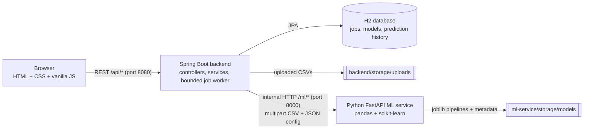

# Diabetes Risk Prediction

**AI/ML Mini Project — AIT**

An educational web application for training and comparing binary classification models on a labelled CSV, then making single predictions with a saved model.

> **Educational project only.** This model is not a medical device and cannot diagnose diabetes. Results depend on the uploaded dataset and model quality. For health concerns, consult a qualified healthcare professional.

---

## Contents

1. [What it does](#what-it-does)
2. [Architecture](#architecture)
3. [Folder structure](#folder-structure)
4. [Prerequisites](#prerequisites)
5. [Setup and run (Linux/macOS)](#setup-and-run-linuxmacos)
6. [Setup and run (Windows)](#setup-and-run-windows)
7. [Using the app](#using-the-app)
8. [CSV requirements](#csv-requirements)
9. [Storage and persistence (H2)](#storage-and-persistence-h2)
10. [REST API](#rest-api)
11. [Tests](#tests)
12. [Verification status](#verification-status)
13. [Troubleshooting](#troubleshooting)
14. [Key terms in plain language](#key-terms-in-plain-language)
15. [Security notes](#security-notes)
16. [Sources for the health facts](#sources-for-the-health-facts)
17. [Third-party assets](#third-party-assets)

---

## What it does

- Upload a labelled CSV (drag and drop or file picker) and see a preview, detected column types, missing values and warnings.
- Follow an 8-step wizard: upload, target, features, train/test split, models, metric, tuning, review.
- Train Logistic Regression, Random Forest and (optionally) Decision Tree models with bounded hyper-parameter search.
- Compare **cross-validation scores (training data)** with **held-out test scores** — kept visibly separate.
- See confusion matrices, ROC curves, metric comparison charts, feature importance/coefficients and classification reports.
- Download a JSON or CSV report for each job.
- Make a prediction with any saved model, using a form generated from that model's feature schema.
- Review training and prediction history. Prediction **inputs are never stored**.

## Architecture



**How a request flows, in plain language**

1. The browser only ever talks to Spring Boot on port 8080. Spring Boot also serves the web pages.
2. **Inspecting a file (wizard step 1):** the browser uploads the CSV; Spring Boot checks it looks like text and forwards it to the Python service, which parses it with pandas and returns a profile (rows, columns, preview, types, missing values, warnings). Nothing is stored at this point.
3. **Training:** the browser uploads the CSV again together with the wizard answers. Spring Boot saves the CSV under a random file name, creates a `TrainingJob` row in H2 with status `QUEUED`, and hands the job to a small fixed-size worker pool. The browser polls the job status.
4. The worker sends the stored CSV and settings to Python. Python validates the data, splits train/test **first**, tunes each model with cross-validation on the training rows only, scores each tuned model once on the test rows, saves each fitted pipeline (preprocessing + classifier) with joblib, and returns the results.
5. Spring Boot stores the results and one `TrainedModel` row per model, then marks the job `COMPLETED` (or `FAILED` with a safe message).
6. **Predicting:** the browser sends feature values to Spring Boot, which checks them against the saved schema and asks Python to run the saved pipeline. Spring Boot logs the predicted class and probability (not the inputs) in `PredictionHistory`.

The CSV is transferred to Python as a **multipart upload** in both inspection and training. Python never receives a file path from the browser.

## Folder structure

```
diabetes-risk-prediction/
├── README.md, .env.example, .gitignore
├── backend/                                  Spring Boot 3 (Java 17+), serves the frontend
│   ├── pom.xml
│   └── src/
│       ├── main/java/edu/ait/diabetesrisk/
│       │   ├── DiabetesRiskApplication.java
│       │   ├── config/      AppProperties, TrainingExecutorConfig (bounded pool), WebConfig (CORS, headers)
│       │   ├── controller/  TrainingJobController, ModelController, HealthController
│       │   ├── service/     TrainingJobService, TrainingWorker, ModelService, PredictionService,
│       │   │                StorageService, UploadValidator, StartupRecovery
│       │   ├── client/      MlServiceClient (+ exceptions) - the only code that calls Python
│       │   ├── dto/         request/response records (entities are never exposed)
│       │   ├── entity/      TrainingJob, TrainedModel, PredictionHistory
│       │   ├── repository/  Spring Data JPA repositories
│       │   └── exception/   ApiException, GlobalExceptionHandler
│       ├── main/resources/
│       │   ├── application.properties, application-local.properties
│       │   └── static/      index, train, results, predict, history (.html)
│       │       ├── css/styles.css
│       │       ├── js/api.js (API client + DOM helpers), dashboard.js, train.js, results.js, predict.js, history.js
│       │       ├── vendor/chart.umd.min.js (Chart.js 4.6.1, MIT)
│       │       ├── fonts/ (Public Sans, Newsreader - SIL OFL)
│       │       └── sample/synthetic_diabetes_demo.csv
│       └── test/            Spring Boot tests + stub ML server replaying real ML responses
├── ml-service/                               Python FastAPI service
│   ├── requirements.txt, pytest.ini
│   ├── app/  main.py, schemas.py, config.py, errors.py, data_validation.py, preprocessing.py,
│   │         training.py, evaluation.py, prediction.py, artifact_store.py
│   └── tests/ conftest.py, test_api.py, test_ml_core.py
├── sample-data/synthetic_diabetes_demo.csv   SYNTHETIC demo data (see below)
└── scripts/  run-ml.sh/.bat, run-backend.sh/.bat, generate_synthetic_data.py
```

Differences from the suggested structure: `ml-service/app/errors.py` holds the single error type; `js/api.js` also contains the small shared DOM helpers (no separate `ui.js`); there is an extra public endpoint `POST /api/datasets/inspect` for wizard step 1, plus `GET /api/summary` (dashboard counts) and `GET /api/predictions` (prediction history). Docker Compose is **not** included (it could not be tested here, and Docker is not needed).

## Prerequisites

| Tool | Version | Check |
|---|---|---|
| Java JDK | 17 or 21 | `java -version` |
| Maven | 3.9+ | `mvn -v` |
| Python | 3.10+ (developed on 3.13) | `python3 --version` (Windows: `py --version`) |
| Browser | any current Chrome, Edge, Firefox or Safari | |

Maven downloads Spring Boot 3.5.7 and the H2 driver from Maven Central on the first build, so the first build needs internet access. Python packages come from PyPI. The frontend needs **no** internet: Chart.js and fonts are bundled.

## Setup and run (Linux/macOS)

Open **two terminals** in the project folder.

**Terminal 1 – ML service (port 8000)**
```bash
cd ml-service
python3 -m venv .venv
source .venv/bin/activate
pip install -r requirements.txt
uvicorn app.main:app --host 127.0.0.1 --port 8000
```
Or simply: `./scripts/run-ml.sh` (creates the venv on first run).

**Terminal 2 – backend + website (port 8080)**
```bash
cd backend
mvn spring-boot:run -Dspring-boot.run.profiles=local
```
Or: `./scripts/run-backend.sh`. The `local` profile turns on the H2 console for localhost; omit it to keep the console off.

Open **http://localhost:8080**. The header shows "Services online" when both services are reachable.

To build a runnable jar instead: `mvn package` then `java -jar target/diabetes-risk-prediction-1.0.0.jar`.

## Setup and run (Windows)

**Command Prompt 1 – ML service**
```bat
cd ml-service
py -3 -m venv .venv
.venv\Scripts\activate
pip install -r requirements.txt
uvicorn app.main:app --host 127.0.0.1 --port 8000
```
Or double-click / run `scripts\run-ml.bat`.

**Command Prompt 2 – backend**
```bat
cd backend
mvn spring-boot:run -Dspring-boot.run.profiles=local
```
Or `scripts\run-backend.bat`. In PowerShell, quote the property: `mvn spring-boot:run "-Dspring-boot.run.profiles=local"`.

Open **http://localhost:8080**.

**Configuration:** copy `.env.example` to `.env` and edit. The `.sh` scripts load `.env` automatically; on Windows, set variables with `set NAME=value` in the same window before starting. Every setting has a default.

## Using the app

**Quick demo (end to end)**

1. Start both services and open http://localhost:8080.
2. Go to **Train Model** and choose **Use the built-in synthetic demo file** (or upload your own CSV).
3. Step 2: the target `Diabetes` is suggested, with positive class `1`.
4. Step 3: `PatientID` is left out automatically because it looks like an identifier.
5. Step 4: keep **80% train / 20% test**. Step 5: Logistic Regression + Random Forest. Step 6: ROC-AUC. Step 7: Balanced.
6. Step 8: review, select **Start Training**, confirm. The page shows the job ID and real status stages until it finishes (about 15–20 s on the demo file).
7. Open **View results** to compare cross-validation and test scores, charts and confusion matrices.
8. Select **Make a prediction with this model**, select **Fill with example values** (training medians), change a value, and select **Predict**. The disclaimer is shown with the result.
9. Refresh the browser or open **History**: jobs and predictions are listed from the database.
10. Stop and restart both services. With the default file-based H2, history and models are still there.

**Wizard questions**

| Step | Question | Notes |
|---|---|---|
| 1 Upload | Which CSV should the model learn from? | CSV only, 20 MB default limit; shows preview, types, missing values; asks where the data comes from (synthetic / real / not sure). |
| 2 Target | Which column contains the answer to predict? | Only columns with exactly two values can be chosen. You confirm which value is the **positive class**; nothing is mapped silently. Imbalance is flagged. |
| 3 Features | Which columns are clues? | Target and ID-like columns are excluded by default; warnings for constant, duplicate, empty and high-missing columns. |
| 4 Split | How much data to hold out for testing? | 80/20 (default), 75/25, 70/30, or custom 50–90% train. Stratified, with a visible random seed (default 42). |
| 5 Models | Which algorithms to compare? | Logistic Regression and Random Forest by default; Decision Tree optional. |
| 6 Metric | What matters most? | ROC-AUC (default), F1, recall, accuracy, precision. Used for tuning and selection; all metrics are still reported. |
| 7 Tuning | How hard to search? | Quick (3-fold), Balanced (5-fold, recommended), Thorough (5-fold, larger but bounded). |
| 8 Review | Does everything look right? | "Back and edit" or "Start Training" (with a confirmation dialog). |

## CSV requirements

- UTF-8 (Latin-1 is also accepted) text with a header row; comma separated (semicolon is detected).
- Unique, non-empty column names; at most 100 columns and 100,000 rows (configurable).
- One **binary target** column (exactly two distinct values, e.g. `0/1`, `Yes/No`). Rows with a missing target are dropped, never guessed.
- At least 20 distinct rows and at least 5 rows of each class (configurable).
- Numeric features are median-imputed and standardised; text features are filled with the most frequent value and one-hot encoded (unknown categories ignored at prediction time). Text features with more than 100 distinct values are rejected.
- Duplicate rows are removed and reported.

**Demo file.** `sample-data/synthetic_diabetes_demo.csv` (also served at `/sample/synthetic_diabetes_demo.csv`) contains **800 synthetic rows** generated by `scripts/generate_synthetic_data.py` with a fixed seed. The rows do not describe real people, and the relationship between columns and the label was chosen arbitrarily so a classifier has something to learn. **Synthetic/demo dataset — results are for software demonstration only.** Columns: `PatientID` (ID), `Pregnancies`, `Glucose`, `BloodPressure`, `BMI`, `DiabetesPedigreeFunction`, `Age`, `PhysicalActivity` (Low/Moderate/High), `FamilyHistory` (Yes/No), `Diabetes` (0/1). A few values are deliberately missing.

## Storage and persistence (H2)

| What | Where (default) | Configure with |
|---|---|---|
| H2 database files | `backend/storage/db/diabetes-risk.mv.db` | `APP_STORAGE_DIR`, `APP_DB_URL` |
| Uploaded CSVs (random UUID names) | `backend/storage/uploads/` | `APP_STORAGE_DIR`, `APP_KEEP_UPLOADS` |
| Trained pipelines + metadata | `ml-service/storage/models/<id>.joblib` and `<id>.json` | `ML_MODEL_DIR` |

- **File-based H2 (default):** jobs, models and prediction history survive restarts.
- **In-memory H2:** set `APP_DB_URL=jdbc:h2:mem:diabetes-risk;DB_CLOSE_DELAY=-1`. Everything in the database is lost on restart (model files remain on disk but are no longer listed).
- Jobs that were queued or running when the backend stopped are marked **failed** at the next start with a clear message, because the worker queue is in memory.
- **H2 console** (only with the `local` profile, localhost only): http://localhost:8080/h2-console, JDBC URL `jdbc:h2:file:./storage/db/diabetes-risk`, user `sa`, empty password. Keep it disabled for any shared or public deployment.

## REST API

Public API (browser → Spring Boot). Errors always use one shape:
```json
{ "status": 400, "code": "INVALID_CONFIG", "message": "The training settings are not valid.",
  "details": ["The target column cannot also be a feature."], "timestamp": "2026-10-28T10:00:00Z" }
```
Status codes: 400 invalid request, 404 missing job/model, 409 results not ready, 413 file too large, 429 queue full, 502 ML service error, 503 ML service unreachable, 500 unexpected (no stack traces or file paths are ever returned).

| Method | Path | Purpose |
|---|---|---|
| GET | `/api/health` | Database and ML service status (always 200) |
| GET | `/api/summary` | Real counts for the dashboard |
| POST | `/api/datasets/inspect` | Profile a CSV (multipart `file`), nothing stored |
| POST | `/api/training-jobs` | Start training: multipart `file` + `config` (JSON). Returns **202** + job |
| GET | `/api/training-jobs?limit=50` | Job history, newest first |
| GET | `/api/training-jobs/{id}` | Job status (`QUEUED`, `RUNNING`, `COMPLETED`, `FAILED`) and stage |
| GET | `/api/training-jobs/{id}/results` | Full results (409 until completed) |
| GET | `/api/training-jobs/{id}/report?format=json\|csv` | Downloadable report |
| GET | `/api/models` | Available saved models |
| GET | `/api/models/{id}` | Model details including the feature schema |
| POST | `/api/models/{id}/predict` | Predict one record |
| GET | `/api/predictions?limit=20` | Recent predictions (class and probability only) |

Resource DTOs (jobs, models, predictions) use camelCase. The `inspect` and `results` documents are passed through from the ML service and use snake_case keys; internal artifact IDs and file names are removed from results before they reach the browser.

**Start a training job**
```bash
curl -F "file=@sample-data/synthetic_diabetes_demo.csv" \
     -F 'config={"targetColumn":"Diabetes","featureColumns":["Pregnancies","Glucose","BloodPressure","BMI","DiabetesPedigreeFunction","Age","PhysicalActivity","FamilyHistory"],"trainFraction":0.8,"algorithms":["logistic_regression","random_forest"],"scoringMetric":"roc_auc","tuningLevel":"balanced","randomSeed":42,"positiveClass":"1","datasetOrigin":"synthetic"};type=application/json' \
     http://localhost:8080/api/training-jobs
```
`config` fields: `targetColumn`, `featureColumns` (1–100), `trainFraction` (0.5–0.9), `algorithms` (`logistic_regression`, `random_forest`, `decision_tree`), `scoringMetric` (`roc_auc`, `f1`, `recall`, `accuracy`, `precision`), `tuningLevel` (`quick`, `balanced`, `thorough`), `randomSeed`, optional `positiveClass`, optional `datasetOrigin` (`real`, `synthetic`, `unknown`).

**Predict**
```bash
curl -H "Content-Type: application/json" \
     -d '{"values":{"Pregnancies":2,"Glucose":150,"BloodPressure":70,"BMI":33.1,"DiabetesPedigreeFunction":0.5,"Age":45,"PhysicalActivity":"Low","FamilyHistory":"Yes"}}' \
     http://localhost:8080/api/models/1/predict
```
Response (abridged): `{"predictedClass":"1","positiveClassPredicted":true,"probabilityPositive":0.82,"classProbabilities":{"1":0.82,"0":0.18},"warnings":[],"disclaimer":"Educational project only. ..."}`. Values must use the exact feature names in the model schema; missing or extra names return 400 `INCOMPATIBLE_FEATURES`.

**Internal ML API** (Spring Boot → Python only): `GET /ml/health`, `POST /ml/inspect` (multipart `file`), `POST /ml/train` (multipart `file` + `config` JSON with snake_case keys: `job_id`, `target_column`, `feature_columns`, `train_fraction`, `algorithms`, `scoring_metric`, `tuning_level`, `random_seed`, `task_type`, `positive_class`), `POST /ml/predict` (`{"model_id": "...", "values": {...}}`). Training is synchronous inside the worker thread, so `/ml/jobs/{id}` is not needed. Interactive docs: http://127.0.0.1:8000/ml/docs.

## Tests

```bash
# ML service (from ml-service/, venv active)
python -m pytest -q

# Backend (from backend/) - starts H2 in memory and a stub ML server
mvn test
```

ML tests cover: health; inspection of valid, empty, header-only, malformed, binary, wrongly named, duplicate-header and oversized files; training on valid data; missing target; missing features; target used as feature; one-class, multi-class and continuous targets; text labels needing a positive class; missing labels dropped not imputed; too-small data; invalid config; prediction (valid, missing/extra features, wrong types, out-of-range warnings, unknown model, path-like IDs); internal API key; reproducible and stratified splits; metric correctness against scikit-learn; undefined ROC-AUC reported as undefined; preprocessing fitted on the training split only; saved pipeline reload; constant and high-cardinality features.

Backend tests cover: H2 tables created; health; inspect pass-through and invalid uploads (empty, wrong extension, binary content); full job flow (create → poll → results → CSV report → model detail → predict → history); no internal IDs, file paths or stack traces in responses; validation errors; 404s; malformed JSON; static pages served with the footer branding; ML service down (503, degraded health, job fails with a safe message, 409 for results); 413 for oversized uploads. The stub ML server replays JSON captured from the real Python service.

## Verification status

What was actually run while building this project (October 2026):

- **ML service:** `pytest` — **40 passed** (Python 3.13, scikit-learn 1.9.1, pandas 3.1, FastAPI 0.162).
- **Frontend + ML service end to end:** a headless Chromium walkthrough drove the real pages (dashboard → full wizard → training → results → prediction → history), checked answer retention on Back, upload and split validation errors, the out-of-range warning and disclaimer, and verified no horizontal scrolling at 390 px width. A saved model still predicted after restarting the ML service. Because the backend could not be built (next point), the browser talked to a temporary stand-in that mirrors the Spring Boot API contract; that stand-in is **not** part of this project.
- **Spring Boot backend:** **not compiled or tested** in the build environment, because its network policy blocked Maven Central. The Java sources were syntax-checked with `javac` (no parse errors). Run `mvn test` before relying on it; please report any compile errors.

## Troubleshooting

| Symptom | Fix |
|---|---|
| Header shows "ML service offline" | Start the ML service (Terminal 1). Check `ML_SERVICE_URL` if it runs elsewhere. |
| Header shows "Server offline" | The backend is not running on port 8080, or a different `SERVER_PORT` is set. |
| `Port 8080 was already in use` | Stop the other program or set `SERVER_PORT=8081`. |
| `ML_AUTH_FAILED` | `ML_INTERNAL_API_KEY` differs between the two services; set the same value on both (or unset on both). |
| Upload returns 413 | File exceeds 20 MB. Raise `APP_MAX_UPLOAD_SIZE`, `APP_MAX_REQUEST_SIZE` and `ML_MAX_UPLOAD_BYTES` together. |
| "Only one value" / "More than two values" on the target step | The column is not a binary label. Pick another column or prepare a two-class label. |
| Job fails with "did not respond in time" | Use Quick tuning, fewer rows, or raise `ML_TRAINING_TIMEOUT`. |
| Job shows "The server restarted before this job finished" | Expected after a backend restart during training; start a new job. |
| `pip install` fails on Windows | Use 64-bit Python 3.10–3.13 and upgrade pip: `python -m pip install --upgrade pip`. |
| H2 console says the database is in use | It is locked by the running backend; use the console at `/h2-console` instead of an external client. |
| Model says "no longer available" | Its file in `ml-service/storage/models` was deleted; train again. |

## Key terms in plain language

- **Target (label):** the known answer the model learns to predict, e.g. `Diabetes` = 1 or 0.
- **Feature:** an input column the model uses as a clue.
- **Train/test split:** the rows are divided once. The model learns only from the training part; the test part is kept locked away and used once at the end to see how the model does on data it has never seen.
- **Stratified split:** both parts keep the same proportion of each class.
- **Cross-validation (CV):** the training rows are split into k folds; the model is trained k times, each time scored on a different fold. The average is a fair estimate used to choose settings and the best model, without touching the test set.
- **Logistic Regression:** despite the name, it is used here for **classification**. It combines the inputs with weights and turns the result into a probability between 0 and 1. Simple, interpretable baseline.
- **Random Forest:** many decision trees trained on random samples of the data; they vote. Can capture non-linear patterns.
- **Decision Tree:** a single flowchart of yes/no questions on the inputs.
- **Accuracy:** share of all predictions that are correct. Can be misleading when one class is much more common.
- **Precision:** of the cases predicted positive, the share that really are positive (fewer false alarms = higher).
- **Recall:** of the real positive cases, the share the model finds (fewer misses = higher).
- **F1-score:** a single number that balances precision and recall (their harmonic mean).
- **ROC-AUC:** how well the model ranks positive cases above negative ones across all thresholds. 0.5 is chance, 1.0 is perfect.
- **Confusion matrix:** a 2×2 table of correct and incorrect predictions by class.

**Educational performance is not clinical validity.** A good test score here means the model fits patterns in the uploaded file. It says nothing about safety or accuracy for real patients, which would need properly collected data, external validation, calibration and regulatory review. The probability shown on the Predict page is a model-estimated probability, not a calibrated personal medical risk. Feature importance and coefficients describe what the model used; they are not causes and not clinical significance.

## Security notes

- The browser calls only Spring Boot. The Python service binds to `127.0.0.1` by default; set `ML_INTERNAL_API_KEY` on both services if it is reachable by anything else.
- Uploaded files are stored under random names inside a fixed folder (path traversal is rejected); file names and content types are not trusted, and the bytes are checked for text before parsing.
- Only pipelines generated by this application are loaded; there is no way to upload a model file. Model IDs are validated before any file access.
- Size, row, column, category and queue limits are configurable; parameter grids are fixed and bounded; the worker pool and queue are bounded (429 when full).
- Raw CSV rows and prediction inputs are never logged. Prediction inputs are not stored.
- Responses never include stack traces or file system paths. Pages are served with a Content-Security-Policy that only allows same-origin scripts.
- The H2 console is off unless the `local` profile is active, and even then only accepts localhost connections.

## Sources for the health facts

The "Did you know?" cards on the dashboard paraphrase these pages (checked October 2026):

- World Health Organization — Diabetes fact sheet: https://www.who.int/news-room/fact-sheets/detail/diabetes
- US Centers for Disease Control and Prevention — Symptoms of Diabetes: https://www.cdc.gov/diabetes/signs-symptoms/
- US National Institute of Diabetes and Digestive and Kidney Diseases — Diabetes & Prediabetes Tests: https://www.niddk.nih.gov/health-information/professionals/clinical-tools-patient-management/diabetes/diabetes-prediabetes

No statistics or clinical claims beyond these general facts are made, and the app gives no medication or treatment advice.

## Third-party assets

- Chart.js 4.6.1 — MIT License (`static/vendor/CHART_JS_LICENSE.md`).
- Public Sans and Newsreader fonts — SIL Open Font License 1.1 (`static/fonts/OFL-*.txt`), via Fontsource.
